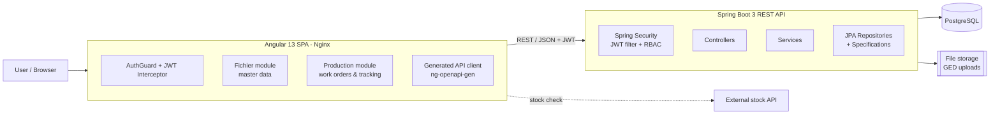
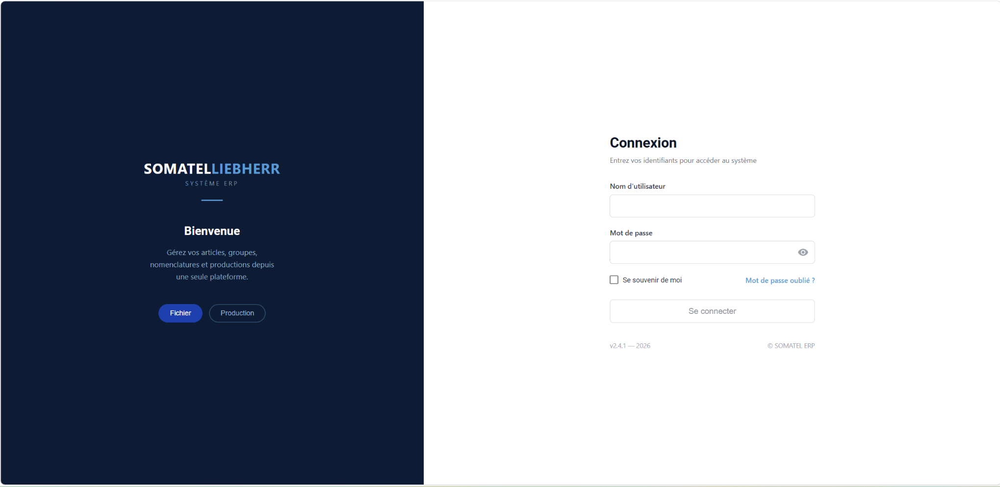
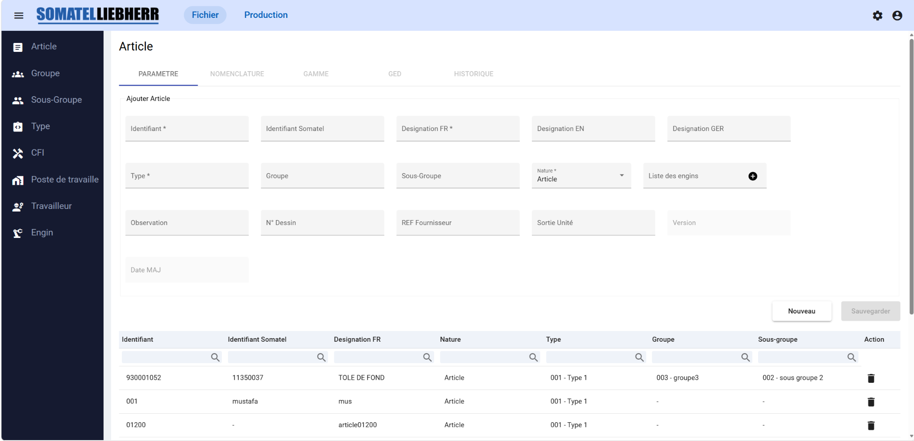
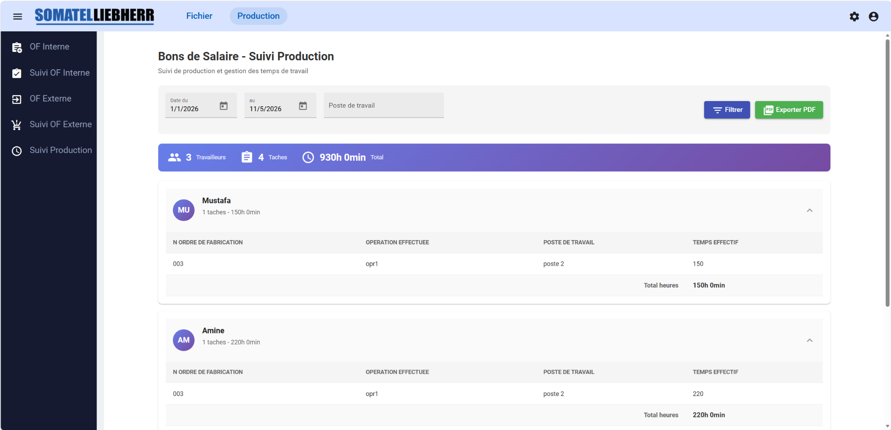

# GPAO Production Manager


> A full-stack **Manufacturing / Production Management (GPAO / MES)** web application built with **Angular 13** and **Spring Boot 3**, designed for an industrial workshop: master data, bills of materials, manufacturing routings, work orders (internal and subcontracted), shop-floor tracking and printable production documents.

---

## Table of Contents
1. [Project Overview](#project-overview)
2. [Key Features](#key-features)
3. [Technologies Used](#technologies-used)
4. [Architecture](#architecture)
5. [Project Structure](#project-structure)
6. [Prerequisites](#prerequisites)
7. [Installation](#installation)
8. [Configuration](#configuration)
9. [Environment Variables](#environment-variables)
10. [How to Run the Project](#how-to-run-the-project)
11. [API Documentation](#api-documentation)
12. [Screenshots](#screenshots)
13. [Future Improvements](#future-improvements)
14. [Author](#author)

---

## Project Overview

**GPAO Production Manager** (*Gestion de Production Assistée par Ordinateur*) digitalizes the production workflow of a mechanical manufacturing plant (assembly, welding, machining).

It replaces paper-based processes by centralizing:

- **Master data** — articles (parts), groups, sub-groups, types, cost centers, workstations, workers and machines.
- **Engineering data** — bills of materials (*nomenclatures*) and manufacturing routings (*gammes*).
- **Production** — internal work orders (*OF internes*), subcontracted work orders (*OF externes*) and their operation-by-operation tracking.
- **Documents** — attached technical documents (GED) and generated PDF shop documents (routing sheets, wage vouchers, production summaries).

The application is composed of a **REST API** (Spring Boot + PostgreSQL) secured with **JWT**, and an **Angular SPA** with lazy-loaded feature modules and a type-safe API client generated from the OpenAPI specification.

---

## Key Features

### 🔐 Security & Access Control
- Stateless authentication with **JWT** (`/api/auth/login`), passwords hashed with **BCrypt**.
- **Role-based access control** (`ROLE_ADMIN`, `ROLE_USER`) enforced by Spring Security.
- **Permission-driven navigation**: permissions (route + icon) are embedded in the JWT and used to build the user's menu dynamically.
- Admin screens to manage **users**, **roles** and role/permission assignment.
- Angular `AuthGuard` and HTTP `AuthInterceptor` (automatic Bearer token injection).

### 📦 Master Data Management (“Fichier” module)
- **Articles** with multilingual labels (FR / EN / DE), drawing number, supplier reference, type, group, sub-group and linked machines.
- Parent/child article hierarchy and **modification history** for articles.
- CRUD screens for **groups, sub-groups, types, cost centers (CFI), workstations, workers and machines (engins)**.

### 🛠️ Engineering Data
- **Bill of Materials (Nomenclature)** per article, with a **stock availability check** against an external stock service.
- **Manufacturing routings (Gammes)**: operations, workstation, preparation time, execution time.
- **Electronic Document Management (GED)**: upload documents (multipart, drag & drop) and attach them to articles.

### 🏭 Production Management (“Production” module)
- **Internal work orders (OF internes)** with detail view.
- **Work order tracking** operation by operation: start/end dates, workers assigned and effective time per worker.
- **Subcontracted work orders (OF externes)** with unit-piece management and progress tracking (gauge charts).
- **Production tracking** dashboard.

### 📄 PDF Generation
- Client-side PDF generation with **pdfmake**: routing sheets, wage vouchers (*bons de salaire*), work order documents and global production summaries.

### ⚙️ Technical Highlights
- Generic **server-side pagination, sorting and dynamic filtering** using JPA `Specification`s.
- **OpenAPI / Swagger UI** with grouped API definitions per domain.
- Angular API layer **auto-generated** with `ng-openapi-gen`.
- Centralized exception handling (`@ControllerAdvice`).
- **Dockerized** frontend (multi-stage build served by Nginx) and backend.

---

## Technologies Used

| Layer | Technologies |
|-------|--------------|
| **Frontend** | Angular 13, TypeScript 4.6, RxJS 7, Angular Material & CDK, Bootstrap 4, ngx-charts, pdfmake, ngx-file-drop, ngx-toastr, Moment.js |
| **Backend** | Java 17, Spring Boot 3.3 (Web, Data JPA, Security), JJWT 0.11, Lombok, springdoc-openapi 2.6 |
| **Database** | PostgreSQL (Hibernate / JPA) |
| **API tooling** | OpenAPI 3, Swagger UI, ng-openapi-gen |
| **Testing** | Jasmine & Karma (frontend), JUnit 5 / Spring Boot Test (backend) |
| **DevOps** | Docker, Docker Compose, Nginx, Maven |

---

## Architecture



**Backend layering:** `controller` → `service/interfaces` + `service/services` → `repository` → `model` (JPA entities & DTOs), with cross-cutting `security`, `config` and `shared` (pagination, filtering, exceptions) packages.

**Frontend organization:** `core` (auth, guards, interceptors, models), `dashboard` (lazy-loaded `fichier` and `production` feature modules), `shared` (reusable table, multi-select table, delete dialog, utilities) and `api-v2` (generated services and models per domain).

---

## Project Structure

```
gpao-production-manager/
├── backend/                          # Spring Boot REST API
│   ├── src/main/java/com/idweb/somatel_liebherr/
│   │   ├── config/                   # Security, Swagger, data initializer
│   │   ├── controller/               # REST controllers (20)
│   │   ├── model/                    # JPA entities, DTOs, enums
│   │   ├── repository/               # Spring Data JPA repositories
│   │   ├── security/                 # JWT utils, filter, UserDetailsService
│   │   ├── service/                  # Business interfaces & implementations
│   │   └── shared/                   # Pagination, filtering, exception handling
│   ├── src/main/resources/           # application*.properties
│   ├── src/test/                     # Spring Boot tests
│   ├── Dockerfile
│   └── pom.xml
├── frontend/                         # Angular 13 SPA
│   ├── src/api-v2/                   # Generated API client (ng-openapi-gen)
│   ├── src/app/
│   │   ├── core/                     # Auth service, guard, interceptor, models
│   │   ├── dashboard/
│   │   │   ├── fichier/              # Master data module
│   │   │   ├── production/           # Work orders & tracking module
│   │   │   ├── login/
│   │   │   └── top-menu/
│   │   └── shared/                   # Reusable components & utilities
│   ├── src/environments/
│   ├── Dockerfile
│   ├── nginx.conf
│   └── package.json
├── docs/
│   └── screenshots/
├── docker-compose.yml
├── .env.example
├── .gitignore
└── README.md
```

---

## Prerequisites

| Tool | Version |
|------|---------|
| Java JDK | 17 |
| Maven | 3.9+ (or the included Maven Wrapper) |
| Node.js | 16.x (recommended for Angular 13) |
| npm | 8+ |
| Angular CLI | 13.3 (`npm install -g @angular/cli@13`) |
| PostgreSQL | 14+ |
| Docker & Docker Compose | optional |

---

## Installation

```bash
# 1. Clone the repository
git clone https://github.com/<your-username>/gpao-production-manager.git
cd gpao-production-manager

# 2. Create your local environment file
cp .env.example .env        # then edit the values

# 3. Create the database
psql -U postgres -c "CREATE DATABASE somatelliebherr;"

# 4. Install frontend dependencies
cd frontend
npm install
```

The database schema is created/updated automatically by Hibernate (`ddl-auto=update`) at backend startup.

---

## Configuration

| File | Purpose |
|------|---------|
| `backend/src/main/resources/application.properties` | Default (development) profile — port `8088` |
| `backend/src/main/resources/application-prod.properties` | `prod` profile used by Docker — port `8080` |
| `frontend/src/environments/environment.ts` | Dev API URL (`http://localhost:8088`) |
| `frontend/src/environments/environment.prod.ts` | Prod API URL (`http://localhost:8888`) |
| `frontend/proxy.conf.json` | Dev proxy to the external stock API |
| `frontend/openapi-config.json` | ng-openapi-gen configuration |

All sensitive values (database password, JWT secret) are read from **environment variables** — no secret is stored in the repository.

---

## Environment Variables

| Variable | Required | Default | Description |
|----------|:-------:|---------|-------------|
| `DB_URL` | no | `jdbc:postgresql://localhost:5432/somatelliebherr` | JDBC connection URL |
| `DB_USERNAME` | no | `postgres` | Database user |
| `DB_PASSWORD` | **yes** | – | Database password |
| `JWT_SECRET` | **yes** | – | HMAC-SHA256 signing key (**≥ 32 characters**) |
| `JWT_EXPIRATION` | no | `86400000` | Token validity in ms (24h) |
| `FILE_UPLOAD_DIR` | no | `./uploads` | Storage folder for GED documents |
| `SERVER_PORT` | no | `8088` (dev) / `8080` (prod) | Backend HTTP port |

See [`.env.example`](.env.example).

---

## How to Run the Project

### Option 1 — Local development

**Backend**
```bash
cd backend
# Linux / macOS
export DB_PASSWORD=your_password JWT_SECRET=$(openssl rand -base64 48)
./mvnw spring-boot:run

# Windows (PowerShell)
$env:DB_PASSWORD="your_password"; $env:JWT_SECRET="replace-with-a-long-random-secret-of-32-chars-min"
.\mvnw.cmd spring-boot:run
```
API available at `http://localhost:8088`.

**Frontend**
```bash
cd frontend
npm start
```
Application available at `http://localhost:4200`.

### Option 2 — Docker Compose

```bash
# Build the backend JAR first (the backend Dockerfile copies target/somatel-liebherr.jar)
cd backend && ./mvnw clean package -DskipTests && cd ..

# Start PostgreSQL, backend and frontend
docker compose --env-file .env up --build
```

| Service | URL |
|---------|-----|
| Frontend | http://localhost:4100 |
| Backend API | http://localhost:8888 |
| Swagger UI | http://localhost:8888/swagger-ui.html |

### Default accounts (development only)

On first startup, `DataInitializer` seeds the roles, permissions and two accounts:

| Username | Password | Role |
|----------|----------|------|
| `admin` | `admin123` | ROLE_ADMIN |
| `user` | `user123` | ROLE_USER |

> ⚠️ Change these passwords immediately in any non-local environment.

### Tests

```bash
cd frontend && npm test          # Karma / Jasmine
cd backend  && ./mvnw test       # JUnit 5 (context load test, requires a database)
```

### Regenerate the Angular API client

```bash
cd frontend && npm run openapiGen:api
```

---

## API Documentation

Interactive documentation is exposed by **springdoc-openapi**:

- Swagger UI: `http://localhost:<port>/swagger-ui.html`
- OpenAPI JSON: `http://localhost:<port>/v3/api-docs`

All endpoints except `/api/auth/**` and Swagger require the header `Authorization: Bearer <token>`.

| Domain | Base path | Main operations |
|--------|-----------|-----------------|
| Authentication | `/api/auth` | `POST /login` |
| Users *(admin)* | `/api/users`, `/api/user/me` | CRUD, `POST /assign-roles`, current user |
| Roles *(admin)* | `/api/roles` | CRUD |
| Permissions *(admin)* | `/api/permissions` | list |
| Articles | `/api/v1/article` | CRUD, `GET /child/{id}`, `GET /history/{id}` |
| Groups / Sub-groups | `/api/v1/group`, `/api/v1/sous-group` | CRUD |
| Types | `/api/v1/type` | CRUD |
| Cost centers | `/api/v1/cfi` | CRUD |
| Workstations | `/api/v1/workstation` | CRUD |
| Workers | `/api/v1/travailleur` | CRUD |
| Machines | `/api/v1/engin` | CRUD |
| Bill of materials | `/api/v1/nomenclature` | CRUD, `GET /all/{id}`, `POST /all` |
| Routings | `/api/v1/gamme` | CRUD |
| Documents (GED) | `/api/v1/ged` | multipart upload, CRUD |
| Internal work orders | `/api/v1/of_intern` | CRUD, `GET /{id}/detail` |
| Work order tracking | `/api/v1/of_suivi` | CRUD, `nomenclature_of`, `GET /work-by-travailleur` |
| Worker time tracking | `/api/v1/suivi_of_travailleur` | CRUD, by work order / by worker |
| External work orders | `/api/v1/of_extern` | CRUD, `/pieces-unitaire` |
| External tracking | `/api/v1/of_suivi_extern` | CRUD |

**Example — login**
```bash
curl -X POST http://localhost:8088/api/auth/login \
  -H "Content-Type: application/json" \
  -d '{"username":"admin","password":"admin123"}'
```

---

## Screenshots

> Screenshots are stored in [`docs/screenshots/`](docs/screenshots).

| Login | Articles |
|-------|----------|
|  |  |

| Work order tracking | Production tracking |
|---------------------|---------------------|
|  |  |

---

## Future Improvements

- Upgrade the frontend to a recent Angular LTS version (standalone components, signals).
- Add database migrations with **Flyway** instead of `ddl-auto=update`.
- Increase test coverage (unit tests for services, integration tests with **Testcontainers**, component tests).
- Add a **CI pipeline** (GitHub Actions) for build, tests and Docker images.
- Multi-stage backend Dockerfile so the JAR is built inside Docker.
- Store GED files in object storage (S3 / MinIO) and validate uploaded file types.
- Refresh tokens and stronger password policy.
- Internationalization (i18n) of the UI.

---

## Author

**Mustafa Derouaz** — Full Stack Developer (Angular / Spring Boot)

- GitHub: [@&lt;your-username&gt;](https://github.com/<your-username>)
- LinkedIn: [linkedin.com/in/&lt;your-profile&gt;](https://www.linkedin.com/in/<your-profile>)
